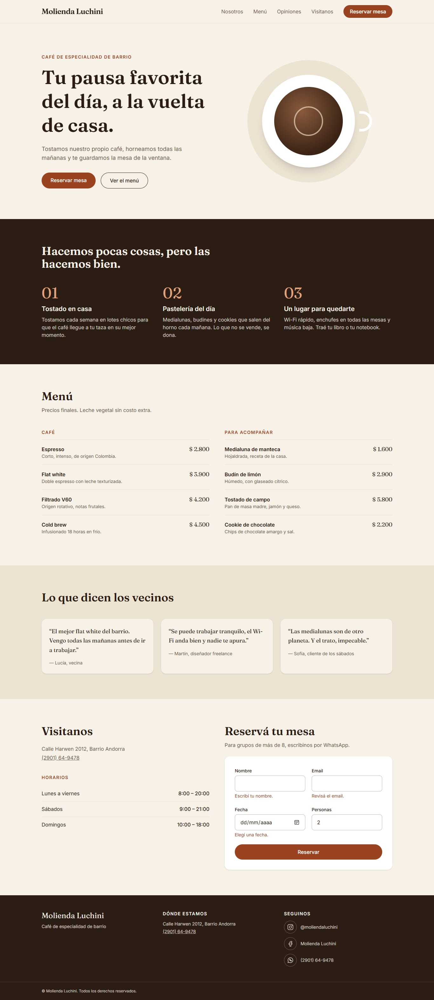
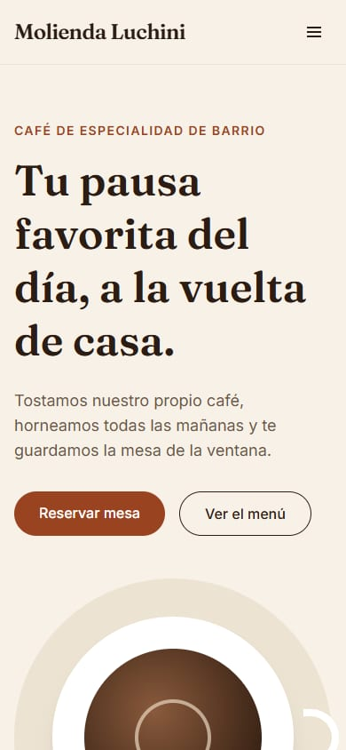

# Molienda Luchini — Landing page

Landing page responsive para **Molienda Luchini**, un café de especialidad de barrio: presentación, menú con
precios, opiniones, horarios, formulario de reserva con validación y redes sociales.
Es un proyecto de portfolio: el negocio, los precios, las opiniones y los datos de contacto son ficticios.

> 🔗 **Demo:** https://luchinileo.github.io/molienda-luchini-landing/

 

## Tecnologías

- [Next.js](https://nextjs.org) (App Router) + React + TypeScript
- Tailwind CSS v4
- Fuentes optimizadas con `next/font` (Inter y Fraunces)

## Qué muestra este proyecto

- **Componentes reutilizables:** cada sección es un componente en `src/components/`.
- **Contenido separado del diseño:** textos, menú y datos de contacto viven en `src/data/content.ts`.
- **Responsive:** pensada primero para celular, con menú desplegable en pantallas chicas.
- **Accesibilidad:** HTML semántico, link para saltar al contenido, colores con contraste WCAG AA,
  errores del formulario asociados a cada campo (`aria-invalid`, `aria-describedby`) y respeto por
  `prefers-reduced-motion`.
- **Formulario con validación** en una función pura (`validateReservation`), separada de la interfaz.
- **Íconos SVG propios**, sin librerías ni imágenes externas.

## Cómo correrlo

Requiere Node.js 20 o superior y pnpm.

```bash
pnpm install
pnpm dev
```

Abrí http://localhost:3000.

## Estructura

```
src/
├── app/          # layout, página principal y estilos globales
├── components/   # Header, Hero, Features, Menu, Testimonials, Visit, ReservationForm, Footer
└── data/         # todo el contenido de la página
```

## Deploy

Se publica como sitio estático en **GitHub Pages**. `next.config.ts` usa `output: "export"`, así que
`pnpm build` genera HTML, CSS y JS en la carpeta `out/`, sin necesidad de un servidor de Node.

Cada push a `main` ejecuta [`.github/workflows/deploy.yml`](.github/workflows/deploy.yml): instala con pnpm,
corre el lint, compila con `BASE_PATH=/molienda-luchini-landing` (la subcarpeta donde vive el sitio) y publica.
Hay que activarlo una sola vez en *Settings → Pages → Source: GitHub Actions*.
